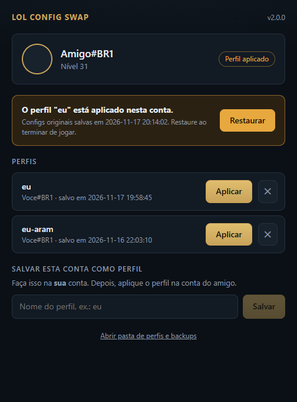

# LoL Config Swap

Leva suas configurações do League of Legends (jogo + client) para a conta de outra pessoa e depois devolve as configs originais dela.

Funciona pela API local do client (LCU). Não toca no processo do jogo.



## Download

Na página de [Releases](../../releases/latest), baixe o `LolConfigSwap-<versão>.exe` (~100 MB). Não precisa instalar nada.

O `.exe` não é assinado, então o Windows SmartScreen pode avisar na primeira execução: clique em **Mais informações → Executar assim mesmo**.

## Uso

1. Logue na **sua** conta, digite um nome (ex.: `eu`) e clique em **Salvar**. Só precisa fazer isso uma vez, ou quando mudar suas configs.
2. Logue na conta do amigo e clique em **Aplicar** no seu perfil. Antes, o app salva um backup das configs dele.
3. Jogue.
4. Depois da partida, clique em **Restaurar**. As configs originais do amigo voltam.

O app percebe sozinho quando você abre o client, troca de conta ou entra em partida.

## O que é trocado

- Jogo: `game-settings` (áudio, vídeo, HUD, mouse, interface) e `input-settings` (atalhos).
- Client: todas as categorias salvas na conta (`/lol-settings/v1/account/*`).
- Configs locais do client (volume e vídeo do client) ficam no PC e não mudam com a conta, então não entram.

## Segurança

- O backup fica em `%LOCALAPPDATA%\LolConfigSwap\backups\<puuid>.json` e **nunca é sobrescrito**: aplicar duas vezes mantém o original.
- Depois de restaurar, o backup vai para `backups\restaurados\`.
- Aplicar e restaurar ficam bloqueados com partida em andamento.
- Perfis e backups criados pela v1 (console) continuam funcionando.
- Se o client fechar no meio, basta logar de novo na conta e restaurar.
- Se o LoL estiver fora de `C:\Riot Games\League of Legends` e o client não for encontrado, defina a variável `LOL_PATH`.

## Build

Requer Node.js. Para rodar em modo de desenvolvimento:

```bash
npm install && npm start
```

Para gerar o `.exe` portátil em `dist/`:

```bash
npm run dist
```
